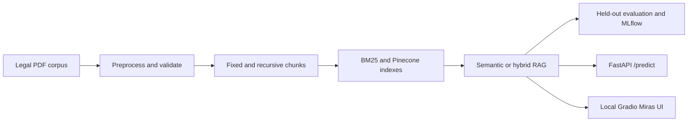

# Legal Inheritance RAG Architecture

An MLflow-traced legal-inheritance RAG service that validates a hybrid retrieval pipeline and serves grounded answers through FastAPI.

## Architecture



This is a training-exempt RAG project: the reproducible modeling stage prepares
and indexes the corpus, evaluates retrieval/generation configurations, and
tracks them in MLflow instead of fitting an unrelated supervised model.

## Quick start

```bash
git clone https://github.com/karnage4/MLOps-for-Legal-Aid-RAG-pipeline.git
cd MLOps-for-Legal-Aid-RAG-pipeline
python -m venv .venv
```

Activate the environment and install the project requirements:

```powershell
# Windows PowerShell
.\.venv\Scripts\Activate.ps1
python -m pip install -r requirements.txt
Copy-Item .env.example .env
```

```bash
# Linux/macOS
source .venv/bin/activate
python -m pip install -r requirements.txt
cp .env.example .env
```

Fill in `PINECONE_API_KEY` and `GROQ_API_KEY` in `.env`, then
run the credential-free tests or start the recommended local interface:

```bash
pytest -q
python gradio_app.py
```

Open `http://127.0.0.1:7860`. The FastAPI service remains available with
`uvicorn src.app:app --host 127.0.0.1 --port 8000`, with interactive API docs
at `http://127.0.0.1:8000/docs`. A live prediction requires the prepared BM25 artifact and the existing
`legal-inheritance-rag` Pinecone index described below.

## Dataset and task

The dataset is a local legal-inheritance PDF corpus organized into five source
folders. Preprocessing accepted 46 of 50 supplied files and produced 3,593
validated recursive chunks plus 883 fixed chunks; four PDFs were skipped
because they contained fewer than 50 extractable characters. The task is to
retrieve relevant passages and generate general inheritance-law information,
then evaluate answer relevance, grounding, sufficiency, correctness, legal
quality, and latency on a shared three-question held-out dataset. Raw source
documents and generated runtime artifacts remain local and are intentionally
excluded from Git.

### Dataset access

The legal-inheritance source corpus is available to instructors, teaching
assistants, and project reviewers through the publicly viewable
[Google Drive corpus folder](https://drive.google.com/drive/folders/103phLHYLT7Pv464nQ47e-lUl_J3DKquT?usp=drive_link).
Anonymous access was verified on 2026-11-05.

Download the folder and preserve its five-subfolder organization before
running `src/preprocess.py`. The preparation pipeline validates extracted
content and may skip PDFs that do not contain enough machine-readable text;
the verified project run accepted 46 of 50 supplied files. Raw PDFs are kept
outside Git to avoid repository bloat and to keep corpus distribution separate
from source code. The files are shared for academic review and reproducibility;
their original publishers or authors retain any applicable rights.

## Project Structure

The codebase is logically split into modular stages corresponding to the data ingestion pipeline and final deployment.

- `src/preprocess.py`: Extracts and recursively chunks raw legal documents from PDF formats.
- `src/prepare_bm25.py`: Builds and validates strategy-specific BM25 artifacts from existing fixed or recursive chunks without contacting Pinecone.
- `src/embed_upsert.py`: Processes continuous text chunks into dense mathematical vectors locally using Sentence Transformers and upserts them to a remote Pinecone Serverless matrix.
- `src/retrieval.py`: Houses the mathematical logic for querying. It executes parallel sparse (BM25) and dense (Pinecone) queries, merging their outputs systematically via Reciprocal Rank Fusion (RRF). 
- `src/generation.py`: Sends retrieved context directly to the configured Groq model with bounded retries for transient provider failures.
- `src/evaluation.py`: Runs reproducible RAG experiments and measures faithfulness and relevancy with a configurable Groq judge.
- `src/genai_dataset.py`, `src/genai_judges.py`, and `src/genai_evaluation.py`: Manage the held-out MLflow dataset, versioned judges, and controlled six-judge evaluations.
- `src/genai_comparison.py`: Resumes and compares the complete eight-profile MLflow GenAI evaluation matrix.
- `src/inference_ablation.py`: Runs the controlled prompt, generation-model, and temperature comparisons.
- `src/app.py`: Serves the existing traced RAG pipeline through a validated FastAPI `/predict` endpoint and generated `/docs`.
- `gradio_app.py`: Provides the local Miras interface while calling the same traced RAG boundary.
- `app.py`: The interactive graphical user interface built entirely natively within Streamlit.
- `artifacts/`: Stores compact, reviewable evaluation evidence while full responses and local runtime state remain ignored.
- `report/generate_m1_report.py`: Reproducibly builds the illustrated Milestone 1 report from tracked artifacts and verified screenshots.
- `output/pdf/legal_aid_rag_milestone1_report.pdf`: Final rendered Milestone 1 report with architecture, metrics, run IDs, screenshots, testing evidence, and contributions.
- `MILESTONE1_BRIEF.md`: Concise requirement tally, champion-challenger analysis, controlled inference findings, and final configuration recommendation.
- `output/pptx/legal_aid_rag_milestone1_brief.pptx`: Editable seven-slide presentation summarizing the milestone evidence and configuration analysis.
- `CONTRIBUTION.md`: Records student names, ERP IDs, and the Milestone 1 member-to-task allocation.

## Detailed setup and dependencies

To execute the data injection and compilation stages locally, you must provide explicit environmental variables.

1. Clone the repository and navigate into the root directory.
2. Create a `.env` file containing the following access keys:
   - `PINECONE_API_KEY=your_pinecone_key`
   - `GROQ_API_KEY=your_groq_key`

3. Install the fundamental Python dependencies:
   ```bash
   pip install -r requirements.txt
   ```

Note: The `requirements.txt` includes advanced dependencies natively required for both the Streamlit UI and local offline dense embedding (`sentence-transformers`, `pinecone[grpc]`, `rank-bm25`). 

## Execution Sequence

The pipeline must be engaged consecutively to ensure structural integrity across the Vector DB and local sparse matrices before opening the application loop.

1. **Preprocessing Phase**:
   Combines and validates raw input documents, then creates fixed and recursive chunk/BM25 artifacts. The existing `bm25_corpus.json` remains the recursive production default.
   ```bash
   python3 src/preprocess.py
   ```

   If the chunk files already exist, regenerate only the fixed BM25 artifact with:

   ```bash
   python -m src.prepare_bm25 --strategy fixed
   ```

   This produces `output/bm25_corpus_fixed.json` and verifies required fields, strategy labels, chunk-index ranges, unique IDs, non-empty text, and exact BM25 ID/text alignment. It does not access or modify Pinecone.

2. **Embedding and Upsert Phase**:
   Transforms and uploads one validated chunking strategy at a time. The
   no-argument/default profile remains recursive and writes to Pinecone's
   default namespace. Fixed chunks use their own cache and the isolated
   `fixed` namespace, so their overlapping IDs cannot replace recursive
   vectors.

   ```bash
   python -m src.embed_upsert --strategy recursive
   python -m src.embed_upsert --strategy fixed
   ```

   The fixed command reads `output/chunks_fixed.json`, caches embeddings in
   ignored `output/embeddings_fixed.json`, validates the 384-dimensional
   cosine index, requires exactly 883 vectors in `fixed`, self-queries three
   representative vectors, and confirms the recursive namespace count did
   not change. It is safe to rerun because Pinecone upserts are idempotent.

3. **Gradio application interface (recommended)**:
   Runs the Miras interface locally with fixed/recursive chunking,
   hybrid/semantic retrieval, source inspection, provider/model metadata,
   and the MLflow-traced pipeline used by the API. Selecting fixed chunking
   routes to `output/bm25_corpus_fixed.json` and Pinecone namespace `fixed`;
   recursive chunking keeps the production-default corpus and namespace. This
   replaces the deprecated Hugging Face Streamlit SDK path while keeping the
   legacy interface available.

   ```bash
   python gradio_app.py
   ```

   Open `http://127.0.0.1:7860`. The first prediction loads and caches the
   retrieval models, so it takes longer than later requests.

   Run the interface adapter tests without cloud calls:

   ```bash
   pytest tests/test_gradio_app.py -q
   ```

4. **Legacy Streamlit interface**:
   Boots the original interface locally for comparison.

   ```bash
   streamlit run app.py
   ```

5. **Prediction API**:
   Starts the FastAPI service with one cached recursive retriever. The serving
   default remains the existing recursive + hybrid + top-5 architecture.

   ```bash
   uvicorn src.app:app --host 127.0.0.1 --port 8000
   ```

   Open `http://127.0.0.1:8000/docs` for the generated interactive API
   documentation or check readiness at `http://127.0.0.1:8000/health`.

   Example prediction request:

   ```bash
   curl -X POST "http://127.0.0.1:8000/predict" \
     -H "Content-Type: application/json" \
     -d '{"query":"Who inherits without a will?","retrieval_mode":"hybrid","top_k":5,"temperature":0.2}'
   ```

   `query` is required and limited to 1,000 characters. `retrieval_mode` must
   be `semantic` or `hybrid`, `top_k` must be between 3 and 10, and
   `temperature` must be between 0 and 1. Unknown request fields are rejected.
   Responses include the answer, provider/model and retry metadata, unique
   source names, retrieved chunk count, and retrieval/generation/total latency;
   full prompts, documents, and credentials are never returned.

   Run the API tests without cloud calls:

   ```bash
   pytest tests/test_api.py -q
   ```

### Configurable retrieval profiles

`RetrievalProfile` keeps the three experiment dimensions together and validates
them before a query runs:

| Chunking strategy | BM25 artifact | Pinecone namespace |
| --- | --- | --- |
| `recursive` | `output/bm25_corpus.json` | default (`__default__`) |
| `fixed` | `output/bm25_corpus_fixed.json` | `fixed` |

Retrieval mode is either `semantic` (Pinecone dense ranking only) or `hybrid`
(BM25 + Pinecone + RRF + cross-encoder reranking), and `top_k` must be at least
one. With no arguments, the application continues to use
`recursive` + `hybrid` + top-5.

```python
from src.pipeline import run_rag_query
from src.retrieval import RetrievalProfile, build_retriever

profile = RetrievalProfile("fixed", "semantic", 3)
components = build_retriever(profile.chunking_strategy)
result = run_rag_query(
    "Who inherits property when there is no will?",
    components,
    temperature=0.2,
    profile=profile,
)
```

The profile verifies that its chunking strategy matches both the loaded BM25
artifact and Pinecone namespace. The selected strategy, mode, namespace, and
top-K are also recorded on the nested MLflow trace.

### Controlled inference ablation

The instructor-required prompt, model, and temperature comparisons use the
same managed three-query dataset and six registered MLflow GenAI judges. The
retrieval configuration is frozen to the selected `fixed-hybrid-top5` profile
so each run changes exactly one generation variable:

| Run | Prompt | Groq model | Temperature | Variable tested |
| --- | --- | --- | ---: | --- |
| `baseline-low-temp` | `strict_grounded_v1` | `qwen/qwen3.8-27b` | 0.1 | Shared control |
| `prompt-structured` | `structured_legal_v2` | `qwen/qwen3.8-27b` | 0.1 | Prompt |
| `model-b` | `strict_grounded_v1` | `openai/gpt-oss-120b` | 0.1 | Model |
| `temperature-high` | `strict_grounded_v1` | `qwen/qwen3.8-27b` | 0.7 | Temperature |

The two prompt variants change only the system instruction. Both receive the
same retrieved context and user question through the shared message template.

#### `strict_grounded_v1` - baseline system prompt

```text
You are a knowledgeable legal assistant specializing in inheritance law.
Your role is to answer questions based strictly on the provided legal context.

Rules you must follow:
- Answer ONLY from the provided context. Do not use outside knowledge.
- If the context does not contain enough information, say:
  "The provided documents do not contain sufficient information to answer this question."
- Cite the source document name when referencing specific rules or sections.
- Be precise and use correct legal terminology.
- Do not give personal legal advice - remind users to consult a qualified lawyer for their specific situation.
```

#### `structured_legal_v2` - structured system prompt

```text
You are an evidence-grounded inheritance-law research assistant.

Use only the supplied legal context. Produce a concise answer with these sections:
1. Direct answer
2. Applicable rule and conditions
3. Sources
4. Important limitation

Requirements:
- Cite the source document for every material legal rule.
- Clearly distinguish general rules from conditional or disputed rules.
- If the context is insufficient, explicitly say what cannot be established.
- Never invent statutes, cases, shares, jurisdictions, or facts.
- Give general legal information only and recommend a qualified lawyer for advice.
```

The common user-message template is:

```text
Using the legal context provided below, answer the following question.

--- LEGAL CONTEXT ---
{retrieved context}
--- END CONTEXT ---

Question: {query}

Answer:
```

Both model IDs were confirmed through the Groq models endpoint and passed a
real short inference preflight on 2026-11-05. Override them without code
changes through `INFERENCE_MODEL_A` and `INFERENCE_MODEL_B` if provider
availability changes. Run or resume the sequential comparison with:

```bash
python -m src.inference_ablation
```

Use `--config <label>` to run one configuration. Completed reports are reused
only when prompt, model, temperature, dataset digest, and judge versions all
match. MLflow records requested and actual model/provider, prompt variant,
temperature, answer-quality assessments, provider behavior, and latency.

Final controlled results verified on 2026-11-05:

| Configuration | Correctness | Legal quality | Retrieval relevance | Avg. total latency | MLflow run |
| --- | ---: | ---: | ---: | ---: | --- |
| Baseline | 0.000 | 0.667 | 0.667 | 28,756 ms | `f8eb6177b0a44c2e91cbd27926ca3efd` |
| Structured prompt | 0.333 | 1.000 | 0.733 | 21,272 ms | `1528a96621d54a93819f01eab6b600a0` |
| GPT-OSS-120B | 0.000 | 0.333 | 0.600 | 20,145 ms | `6db207d1847d4d96af0f42905fcf1bf1` |
| High temperature | 0.000 | 0.667 | 0.600 | 16,698 ms | `caf08bcd4194455f9efc030ffc2a9634` |

All four controlled runs completed with three valid rows and the same six
judge versions. The structured prompt is strongest: it improved correctness and
legal-answer quality while reducing latency. GPT-OSS-120B was faster than Qwen
but reduced legal quality and retrieval relevance. Raising temperature from
0.1 to 0.7 reduced retrieval sufficiency from 0.667 to 0.333 and retrieval
relevance from 0.667 to 0.600, while groundedness increased from 0.667 to
1.000. Because this held-out set has only three examples, latency and quality
deltas are evidence for this milestone rather than broad statistical claims.

### Fixed-profile retrieval smoke test

Run all four fixed retrieval combinations without calling a generation model
or evaluation judge:

```bash
python -m src.retrieval_smoke_test
```

The command builds the fixed BM25 index once, queries only Pinecone namespace
`fixed`, requires exact top-3/top-5 result counts and fixed-strategy metadata,
and reads each MLflow trace back to confirm that `hybrid_legal_retrieval` is a
child of `fixed_retrieval_smoke`. Its detailed local report is written to the
ignored file `output/fixed_retrieval_smoke.json`.

Verified on 2026-10-24:

| Profile | BM25 candidates | Semantic candidates | Returned | Latency | MLflow trace |
| --- | ---: | ---: | ---: | ---: | --- |
| Fixed semantic top-3 | 0 | 20 | 3 | 8,917.83 ms | `tr-16bab80442459f2254969c872c1a390c` |
| Fixed semantic top-5 | 0 | 20 | 5 | 590.65 ms | `tr-884b12d2036c6a7cf570125ef276dd6d` |
| Fixed hybrid top-3 | 20 | 20 | 3 | 11,540.70 ms | `tr-94b7ab775813e06c3e57a2a011297335` |
| Fixed hybrid top-5 | 20 | 20 | 5 | 10,989.34 ms | `tr-477c416ffed26dff909042d956c8735a` |

## Evaluation and Validation

`src/evaluation.py` defines the complete eight-configuration Cartesian matrix
over the same held-out query set. It aggregates faithfulness, relevancy,
success rate, and latency, logs every configuration to MLflow, and selects the
best complete run by mean faithfulness, then mean relevancy, then lower total
latency.

| Chunking | Retrieval | Top K | Pinecone namespace |
| --- | --- | ---: | --- |
| Recursive | Semantic | 3 | default (`__default__`) |
| Recursive | Semantic | 5 | default (`__default__`) |
| Recursive | Hybrid + reranking | 3 | default (`__default__`) |
| Recursive | Hybrid + reranking | 5 | default (`__default__`) |
| Fixed | Semantic | 3 | `fixed` |
| Fixed | Semantic | 5 | `fixed` |
| Fixed | Hybrid + reranking | 3 | `fixed` |
| Fixed | Hybrid + reranking | 5 | `fixed` |

The two BM25 indexes remain separate, while the Pinecone client, embedding
model, and reranker are shared in memory. The complete matrix was executed and
verified in Step 6 as described below.

Every evaluation query is executed through the same traced `run_rag_query` boundary as the application. MLflow therefore stores one `legal_aid_rag_query` parent trace containing the `hybrid_legal_retrieval` and `legal_generation` child spans, rather than separate root traces for retrieval and generation.

The Groq judge model is configured through `GROQ_JUDGE_MODEL` and defaults to `openai/gpt-oss-20b`, keeping judge quota separate from the Qwen generation model. Core evaluation uses one schema-controlled judge request per query to return relevance, groundedness, retrieval relevance, and fractional expected-fact coverage together. This reduces judge calls from seven to one per row while retaining the more capable judge; optional strict and qualitative judges remain registered for diagnostics. `EVALUATION_QUERY_LIMIT` controls the common evaluation-set size and defaults to three queries; `EVALUATION_COOLDOWN_SECONDS` defaults to five seconds between queries.

### Final eight-run comparison (verified 2026-10-24)

All eight configurations evaluated the same three held-out questions, for 24
successful queries and no failures. Direct MLflow readback confirmed that all
runs are `FINISHED`, their recorded parameters match the actual retrievers,
and every run has `success_rate=1.0` and `evaluation.status=passed`. The
reviewable result is stored in
[`artifacts/rag_evaluation_summary.json`](artifacts/rag_evaluation_summary.json).

| Configuration | Mean faithfulness | Mean relevancy | Mean total latency | Successful | MLflow run ID |
| --- | ---: | ---: | ---: | ---: | --- |
| `recursive-semantic-top3` | 0.8889 | 0.7717 | 17,208.0 ms | 3/3 | `db8bf52010044b47a262af5e8add6dda` |
| `recursive-semantic-top5` | 0.7556 | 0.4809 | 6,851.3 ms | 3/3 | `de06c99b5b9d41d89333459657065f59` |
| `recursive-hybrid-top3` | 0.9667 | **0.7860** | 11,799.0 ms | 3/3 | `07be884a244d41c99f5f8540611a07f1` |
| `recursive-hybrid-top5` | 0.7778 | 0.7723 | 9,374.7 ms | 3/3 | `6d8ff2c40dce4ba48aa2bc77f98d95b3` |
| `fixed-semantic-top3` | **1.0000** | 0.7228 | 10,589.7 ms | 3/3 | `73841e75f54b4a968339b8b63943d5d4` |
| `fixed-semantic-top5` | 0.7963 | 0.7501 | 16,014.0 ms | 3/3 | `cc8313f367b7424eba49bf45328803f9` |
| **`fixed-hybrid-top3`** | **1.0000** | 0.7700 | 17,530.0 ms | 3/3 | `ba6464e78f014a6db1d21af5c39d508f` |
| `fixed-hybrid-top5` | 0.6667 | 0.7402 | 15,932.7 ms | 3/3 | `84ec54970978451fb33ace36af25c730` |

`fixed-hybrid-top3` is selected because it ties for the highest mean
faithfulness and has higher mean relevancy than the other 1.0000-faithfulness
configuration. The deterministic rule compares mean faithfulness first, then
mean relevancy, then lower mean total latency. MLflow identifies the selected
run with `evaluation.best_run=true`.

These recorded runs predate the direct-Groq migration. Hugging Face was still
configured as primary, but its requests were unavailable, so Groq produced all
successful answers. Current runtime requests skip Hugging Face entirely.
Transient judge rate limits were handled by bounded retry logic.

### MLflow-managed GenAI evaluation dataset

The three held-out questions are also registered as the reusable,
human-reviewed
MLflow dataset `legal-aid-rag-held-out-v1`. Keeping the dataset separate from
the evaluation runner lets every RAG profile consume exactly the same inputs
with the same approved expectations and registered judge lineage.

Create or verify it with:

```bash
python -m src.genai_dataset --creator "Karam Hussain"
```

The command is idempotent: it reuses the named dataset, links it to the
`legal-aid-rag` experiment, updates its metadata, and adds only missing
questions. The verified dataset is `d-fee7335515b9445dbb7feddfd68de247`
(digest `1f570963`) with three records and creator `Karam Hussain`. An immediate
rerun added zero duplicate records. Because MLflow treats `created_by` as
creation metadata, changing it requires an explicit supported recreation:

```bash
python -m src.genai_dataset --creator "Karam Hussain" --recreate
```

Open the `legal-aid-rag` experiment in MLflow and select **GenAI → Datasets**
to inspect it. After reviewing the legal facts, attach or verify the version-1
expectations with:

```bash
python -m src.genai_expectations --reviewer "Karam Hussain"
```

The expectations use structured `expected_facts`, not one rigid model answer.
They cover intestate heirs, a daughter's conditional Islamic shares, and the
religion-dependent inheritance rule plus its legal-status caveat. The command
upserts by the unchanged input, marks `label_status=human-reviewed`, and is
idempotent. The verified first run updated three existing records; the second
updated zero and left the dataset at exactly three records.

### Registered MLflow GenAI judges

Step 2 registers seven judges under the `legal-aid-rag`
experiment without running the RAG pipeline or calling a judge model:

| Judge | Purpose | Needs expectations? |
| --- | --- | --- |
| `relevance_to_query` | Checks whether the answer addresses the question | No |
| `retrieval_relevance` | Checks whether retrieved chunks are relevant | No |
| `retrieval_groundedness` | Checks whether the answer is supported by retrieval | No |
| `legal_answer_quality` | Checks conditionality, uncertainty, and responsible legal framing | No |
| `fact_coverage` | Scores each expected fact independently and returns the supported fraction | Yes |
| `correctness` | Strict binary check: passes only when every reviewed fact is supported | Yes |
| `retrieval_sufficiency` | Checks whether retrieval can support the reviewed facts | Yes |

Register or verify the definitions with:

```bash
python -m src.genai_judges
```

The command uses `GROQ_JUDGE_MODEL` (default `openai/gpt-oss-20b`) through
MLflow's `groq:/` provider URI. Registration is idempotent: an unchanged
definition reuses its latest version, while a changed definition creates a
new version. Registration itself makes no provider inference call. The versions
pinned by Step 3 are `relevance_to_query:v1`, `retrieval_groundedness:v2`,
`retrieval_relevance:v2`, `fact_coverage:v1`, `correctness:v1`,
`retrieval_sufficiency:v1`, and `legal_answer_quality:v2`; registration reused
the six existing definitions and added `fact_coverage` without inference.
Open **GenAI -> Judges** in the
`legal-aid-rag` experiment to inspect them. The UI's **Evaluating traces** setting is intentionally
`OFF`; Step 3 invokes these registered versions explicitly on the managed
dataset rather than continuously sampling production traces.

`fact_coverage` prevents one omitted fact from collapsing an otherwise useful
answer to zero. It reports `supported facts / total facts` as a 0–1 score and
lists every fact as supported or unsupported in its rationale. The original
`correctness` judge remains available as the stricter all-facts comparison.

### Retrieval latency instrumentation and benchmark

Hybrid retrieval uses configurable candidate limits of 10 BM25 results, 10
semantic results, and at most 12 RRF candidates for cross-encoder reranking.
The limits can be changed with `BM25_CANDIDATE_K`, `SEMANTIC_CANDIDATE_K`, and
`RERANK_CANDIDATE_K` without changing the retrieval architecture. Every MLflow
retrieval span records BM25, embedding, Pinecone, fusion, reranking, and total
retrieval latency separately.

```bash
python -m src.latency_benchmark --strategy fixed --mode hybrid --top-k 5 --repeats 3
```

The verified 45-request warm benchmark produced mean/median/p95 retrieval
latencies of **3,730 / 3,451 / 5,469 ms**. Cross-encoder reranking remained the
largest stage at 87.6% of mean retrieval time. The previous tracked
fixed-hybrid-top5 retrieval mean was 26,287 ms, so the new measured mean is
85.8% lower. Quality must still be re-evaluated under the new seven-judge
lineage before replacing the historical champion.

The first improved managed run, `518b7c4824cb4a74bc9dcbd676058b3a`,
measured **7,434 ms mean end-to-end inference**: 6,099 ms retrieval and 1,335
ms direct Groq generation. Per-fact coverage succeeded on all three rows at
0.75, 0.75, and 0.333 (mean 0.611), whereas strict all-facts correctness was
0.333. The run remains marked `partial` because the separate legacy
retrieval-sufficiency judge produced malformed JSON on two rows; those errors
do not invalidate the latency or fact-coverage measurements.

The corrected core evaluation run `96c173dc72b8408c8541e49ddff7ae7f`
completed all three rows with no missing feedback. It uses one quota-aware,
schema-validated GPT-OSS judge request per query to emit four MLflow feedback
records, reducing judge calls from 21 to 3. The run completed its evaluation
phase in **1:23** and recorded fact coverage **0.7222**, query relevance
**0.8333**, retrieval relevance **0.8333**, and groundedness **0.6000**. Mean
RAG inference was **7,509 ms** (6,098 ms retrieval + 1,411 ms generation).
Strict all-or-nothing correctness remains an optional diagnostic; fractional
fact coverage is the primary correctness signal for profile selection.

New comparison runs write to `*_core_v2.json` artifacts and
`genai_evaluation_comparison_core_v2.json`, so the original six-judge milestone
artifacts are never overwritten.

### Controlled MLflow GenAI evaluation

Run the labeled `fixed-hybrid-top3` evaluation with:

```bash
python -m src.genai_evaluation
```

The runner validates the exact managed dataset and expected facts, loads the
latest registered judge versions, forces single-worker scoring, and reuses the
existing traced RAG chain. The verified run is
`9fcc1af514b046078f04bc2202c5f60a` and is linked to dataset digest `1f570963`.
It produced exactly three traces, each with nested CHAIN, RETRIEVER, and LLM
spans and all six assessments; these were also confirmed in the MLflow UI.

| Metric | Result |
| --- | ---: |
| Query relevance | 1.0000 |
| Retrieval groundedness | 1.0000 |
| Retrieval relevance | 0.7778 |
| Retrieval sufficiency | 0.3333 |
| Correctness against all expected facts | 0.0000 |
| Custom legal-answer quality | 1/3 passed |
| Average retrieval latency | 11,307.0 ms |
| Average generation latency | 2,204.7 ms |
| Average RAG latency | 13,511.7 ms |

This recorded run predates the direct-Groq migration: Groq
`qwen/qwen3.8-27b` produced all three evaluated answers after the former
Hugging Face primary was unavailable. The scores show that answers were relevant and grounded in
retrieved text, while two queries lacked retrieval coverage for every approved
fact and none of the answers satisfied every strict expected fact. Detailed
per-query results are saved in
[`artifacts/genai_evaluation_fixed_hybrid_top3.json`](artifacts/genai_evaluation_fixed_hybrid_top3.json).

### Complete six-judge profile comparison

The resumable managed-dataset comparison subsequently completed all eight
fixed/recursive, semantic/hybrid, and top-3/top-5 profiles with no remaining
configuration. Each valid profile contains three predictions and all six
pinned judge assessments. Run or resume it with:

```bash
python -m src.genai_comparison
```

Under the six-judge ranking rule, `fixed-hybrid-top5` is the selected profile:

| Result | Value |
| --- | ---: |
| MLflow run | `e6034e3cda2f4582ab5fac02132b4687` |
| Correctness | 0.3333 |
| Retrieval sufficiency | 0.3333 |
| Legal-answer quality | 1.0000 |
| Retrieval groundedness | 0.6667 |
| Retrieval relevance | 0.6667 |
| Query relevance | 1.0000 |
| Average total latency | 29,517 ms |

This result does not conflict with the earlier `fixed-hybrid-top3` selection:
the earlier experiment uses the legacy faithfulness/relevancy ranking, whereas
the managed GenAI comparison uses the expanded six-judge rubric and reviewed
expectations. The complete ranking and all eight run IDs are stored in
[`artifacts/genai_evaluation_comparison.json`](artifacts/genai_evaluation_comparison.json).

### Training exemption for this RAG project

This project does not perform task-specific supervised model training. It uses pretrained embedding, reranking, and generation models, so the traditional training requirement is exempted. Its reproducible modeling workflow consists of corpus preparation, embedding/index construction, retrieval configuration, held-out RAG evaluation, experiment tracking, and clearly named evaluation artifacts.

## Deployment Notes

The repository retains its Docker configuration, but Hugging Face Space deployment is intentionally deferred until the milestone's local pipeline, API, and tests are complete.

## MLflow Integration — Phase 1

This working copy preserves the original retrieval architecture while using Groq as the sole generation provider. The retired Hugging Face model and its guaranteed-failure request were removed from the runtime path. `GROQ_API_KEY` is loaded from `.env`; the optional `GROQ_MODEL` selects the generation model and currently defaults to `qwen/qwen3.8-27b`. Transient Groq failures are retried up to `GROQ_MAX_ATTEMPTS` times (default: 3). If no MLflow environment variables are supplied, runs and traces are stored locally in `mlflow.db` under this project folder.

Testing status, evidence, and the handoff rules for later features are maintained in [`MLOPS_LOG.md`](MLOPS_LOG.md). Update that file immediately after each manual test and before opening the next feature branch.

The integration records:

- a root `legal_aid_rag_query` CHAIN span for each Streamlit question;
- a nested `hybrid_legal_retrieval` RETRIEVER span with the actual retrieved chunks;
- a nested `legal_generation` LLM span recording the Groq model, latency, retry count, success status, and sanitized attempt results without recording the provider token;
- a `real-rag-smoke-test` run recording the Test 3 result, provider/model tags, retrieval and generation latency, and trace ID;
- one conventional MLflow run per offline evaluation configuration, including faithfulness, relevancy, and latency metrics.

### Manual test 1: MLflow only — no cloud keys needed

From this directory, install the unchanged RAG environment plus MLflow and run the smoke test:

```bash
python -m pip install -r requirements.txt
python -m src.mlflow_smoke_test
```

A successful run prints JSON containing `"status": "ok"`, a run ID, a trace ID, and these spans:

```text
smoke_rag_chain
smoke_retriever
smoke_llm
```

This proves both standard experiment tracking and GenAI trace storage before Pinecone or Groq are involved.
The first launch can take longer while MLflow creates and migrates the local SQLite schema; subsequent launches reuse that database.

### Manual test 2: inspect the MLflow UI

In a separate PowerShell terminal, first enter this exact project directory.
Do not launch from its parent directory because that may select a different
`mlflow.db`. Resolve the absolute tracking URI before starting the UI:

```powershell
$trackingUri = & ".\.venv\Scripts\python.exe" -c "from src.mlflow_config import default_tracking_uri; print(default_tracking_uri())"
& ".\.venv\Scripts\python.exe" -m mlflow ui --backend-store-uri $trackingUri --port 5000
```

Open `http://127.0.0.1:5000`, select the `legal-aid-rag` experiment, and inspect both the Runs and Traces tabs.

### Manual test 3: run the original RAG app with tracing

Use the same `.env` values as the original project:

```dotenv
PINECONE_API_KEY=your_pinecone_key
GROQ_API_KEY=your_groq_key
GROQ_MODEL=qwen/qwen3.8-27b
GROQ_MAX_ATTEMPTS=3
GROQ_JUDGE_MODEL=openai/gpt-oss-20b
GROQ_JUDGE_REASONING_EFFORT=low
EVALUATION_QUERY_LIMIT=3
EVALUATION_COOLDOWN_SECONDS=5
```

Keep the original `output/bm25_corpus.json` and Pinecone index available, then start:

```bash
streamlit run app.py
```

Or run the repeatable Test 3 check directly:

```bash
python -m src.mlflow_rag_smoke_test
```

Submit one question and refresh the MLflow Traces tab. The query should appear as one chain containing retrieval and generation spans. Groq is called directly with the configured model and bounded transient-error retries. Retrieval content, provider/model selection, latency, retry metadata, and the generated response are stored for debugging; secret values are not logged.

### Manual test 4: evaluation-run logging

After both BM25 artifacts, both Pinecone namespaces, and provider keys are
available:

```bash
python -m src.evaluation
```

The command logs all eight configurations shown above. A passing suite reports
`3/3` successful queries for each run, writes
`artifacts/rag_evaluation_summary.json`, tags the selected run with
`evaluation.best_run=true`, and creates one nested three-span trace per
evaluated query.

### Optional shared tracking server

No additional variable is required for local testing. To send data to a shared MLflow server later, set the standard `MLFLOW_TRACKING_URI` or `MLFLOW_EXPERIMENT_ID` variables before starting the app; the original three RAG credential names remain unchanged.
